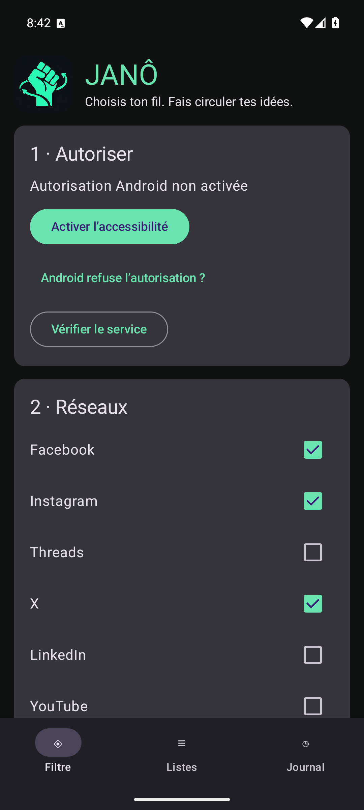
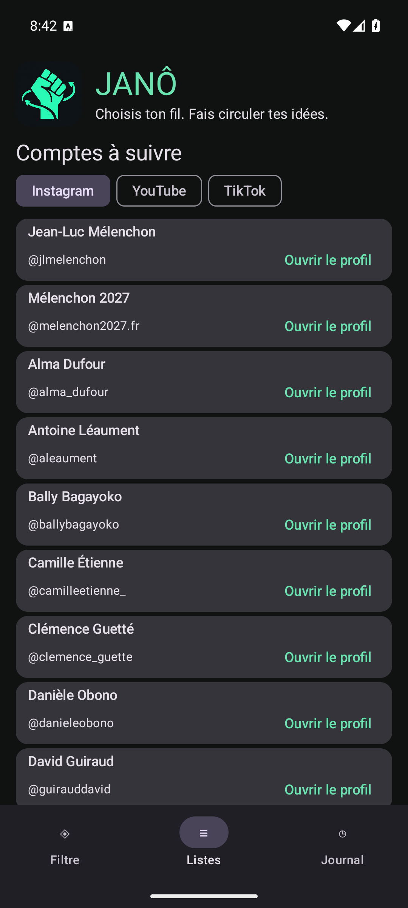
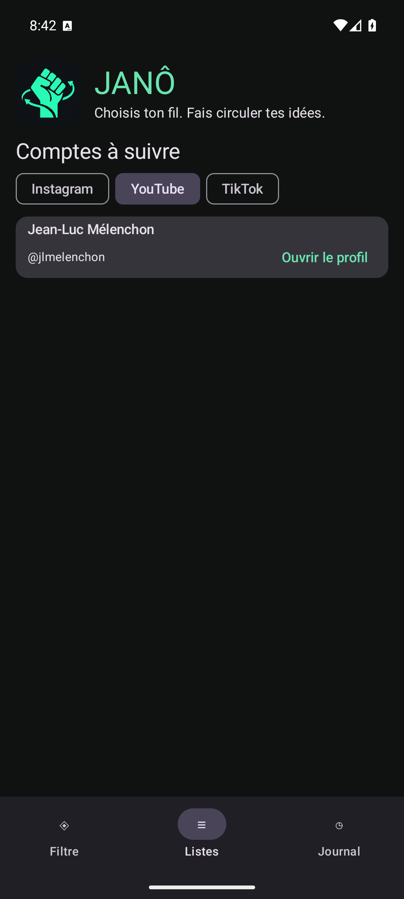
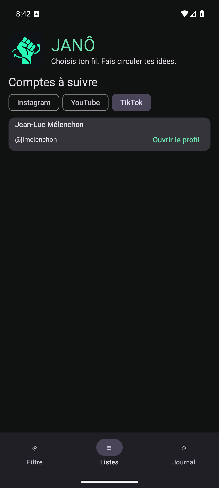
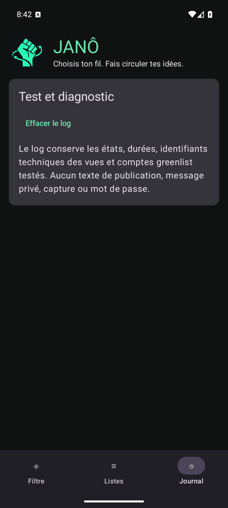

# JANÔ

Choisis ton fil. Fais circuler tes idées.

Application Android de listes sociales et de filtrage.

## Captures d’écran

Captures réelles de l’application exécutée sur un émulateur Android, le 5 novembre 2026 (1080 × 2400).
Installation neuve : l’accessibilité n’est pas encore activée.

| Accueil | Listes Instagram | Listes YouTube |
|---|---|---|
|  |  |  |

| Listes TikTok | Journal |
|---|---|
|  |  |

## Téléchargements — 0.7.0 bêta 1

- [Application Android (APK)](downloads/JANO_0.7.0-beta.1.apk)
- [Sources ZIP](downloads/JANO_0.7.0-beta.1_sources.zip)
- [Empreintes SHA-256](downloads/SHA256SUMS)

## Sources

Le projet Android est dans [android-filter](android-filter). Voir son [README](android-filter/README.md) et les [limites de validation](android-filter/VALIDATION.md).
